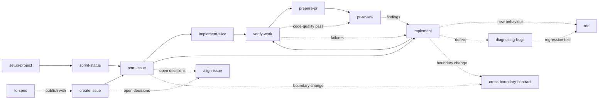
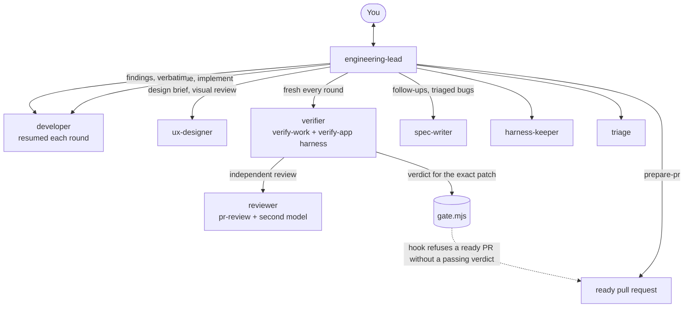

# Agent fleet

A set of agent skills, and a Claude Code agent team that runs them, for building software through one workflow: plan an issue, start it, implement it in reviewable slices, verify it, open a pull request, and review it. The skills work in any project and with any coding agent, whether the project is a web app, an iOS or Android app, a game, a back-end service, a library, or a mix of these in one repository or several.

With Claude Code, the installation also brings [the agent team](#the-agent-team): you talk to one engineering lead, which hands issues to a developer, has every round proven by a fresh verifier that never saw the code being written, and opens the pull request only once a verdict covers the exact patch.

agent-fleet grew out of skill-fleet and replaces it. An update [takes over a skill-fleet installation](#moving-from-skill-fleet) in place.

## How it works: GitHub issues on one board

agent-fleet is opinionated about where work lives. Every project that uses it runs its work through GitHub, and the installer sets that up for you:

- **A GitHub repository.** Issues and pull requests live there. The installer stops when the project folder is not a GitHub repository, and shows how to create one.
- **The GitHub CLI (`gh`), logged in.** The skills and their scripts talk to GitHub through it. When `gh` is missing, the installer offers to install it, with Homebrew on macOS or winget on Windows, and otherwise points to [cli.github.com](https://cli.github.com). When `gh` is not logged in, or its login lacks the `project` scope the board needs, it offers to fix that in your browser.
- **A GitHub Project board linked to the repository.** The board has a `Status` field with the options `Todo`, `In progress`, `In review`, and `Done`, and a `Sprint` field with two-week sprints. When the repository has no linked board, the installer links the board the last installation recorded again, if it is still open. Otherwise it creates one called `<repository> Sprints`, or links one of your existing boards if you pick it. It never creates a board whose title an open board of yours already has, because the sprint skills find the board by its title and stop when two boards share it. It asks you to link that board instead. When a linked board lacks a status option or the Sprint field, it adds them without touching the options already in use. It asks before it creates, links, or repairs a board.

The skills then move each issue across the board:

| Status | Set by |
| --- | --- |
| `Todo` | `create-issue`, when it files the issue |
| `In progress` | `start-issue`, when work begins on a branch |
| `In review` | `prepare-pr`, when the pull request is ready for review |
| `Done` | GitHub's built-in project workflow, when the issue closes |

`sprint-status`, `sprint-recap`, and `repos-report` read the Sprint field to report on the current sprint. The board is not optional. When it is missing or incomplete, a skill stops and asks you to run `npx agent-fleet@latest update --dry-run` and then `npx agent-fleet@latest update` in your own terminal. The update creates or repairs the project board on GitHub, so the agent never runs it without your approval. If you ask the agent to run it, the agent runs `npx agent-fleet@latest update --dry-run --yes` and shows you the plan. It runs `npx agent-fleet@latest update --yes`, with the same flags, only after you approve that exact plan. A choice you make, such as `--board 3`, goes into both runs. Both take `--yes` because without a terminal the update answers its own questions, such as which board to link, so a dry run in your terminal could plan a different board. `--force`, which overwrites files you changed by hand, needs its own approval. The board starts with six sprints, about three months; add more in the Sprint field's settings on GitHub when they run out.

## How one skill set fits every project

Three layers keep the skills general:

| Layer | Lives in | Holds | Changes when |
| --- | --- | --- | --- |
| Skills | `skills/` → a project's `.agents/skills/` | The workflow: what to read, what to check, what never to do without approval | The workflow improves |
| Project profile | a project's `docs/agents/` | Tracker, board, lifecycle statuses, routing, reading order, boundaries, commands, evidence, protected files | The project changes |
| Shared references | `references/` → a project's `.agents/references/` | The 16 quality characteristics, GitHub link rules, subagent rules, and one guide per platform | The model or a platform's practice changes |

A skill never says "run `npm run build`" or "move the issue on the Roadmap board". It says "run the final verification in `docs/agents/verification.md`" and "move the issue to the started status on the board in `docs/agents/issue-tracker.md`". The [project profile reference](references/project-profile.md) defines the three profile files and how skills treat a missing, `TODO`, or `None` value.

Platform differences live in the [platform guides](references/platforms/README.md): `web`, `mobile`, `desktop`, `game`, `service`, and `library-cli`. Each gives the default test seams, runtime evidence, bug feedback loops, compatibility risks, and visible-first build order for that kind of software. The profile names each component's platform, so `verify-work` knows that a web change needs a browser pass, an iOS change needs simulator and device evidence kept apart, and a game change needs a play-test and a profiler capture on target hardware.

## Install into a project

Run the installer from the project's root folder with any package manager. It needs Node.js 20 or later:

```sh
npx agent-fleet@latest        # npm
pnpm dlx agent-fleet@latest   # pnpm
yarn dlx agent-fleet@latest   # Yarn 2 or later; with Yarn 1, use npx
bunx agent-fleet@latest       # Bun
```

It first checks GitHub as described [above](#how-it-works-github-issues-on-one-board): the GitHub CLI, its login, the repository, and the board. Then it asks three questions, sets up the board, and copies the fleet into the project so the project stays self-contained for collaborators who never run the installer:

1. **Which coding tools should get skill adapters?** Claude Code, Cursor, and Kiro each read skills from their own folder, so each gets a thin adapter that points at the canonical skill. Codex and OpenCode read `.agents/skills/` directly and need none. Choosing Claude Code also installs [the agent team](#the-agent-team).
2. **Create or update `AGENTS.md` and `CLAUDE.md`?** Described below.
3. **Overwrite the conflicting files?** Asked only when a file the fleet would write already exists and the fleet did not write it, or you changed it since. The answer defaults to no.

Commit the project before you install or update. A file the fleet overwrites keeps its earlier version only in Git, and `setup-project` reads it there to carry its project facts into the profile.

When several boards could serve the repository, it also asks which one to use, and it asks before it creates, links, or repairs the board. `--yes` skips every question. It keeps the choices recorded by the last installation, or uses Claude Code, Cursor, and the instruction files the first time, and it makes the board changes the workflow needs, within the limits the next paragraph describes.

Without a terminal, such as in CI, the installer asks nothing and keeps the recorded choices, but it changes the board only with `--yes`, or, for a link, with the board named by `--board`. A run that would change the board without that consent lists the planned board changes, writes nothing on GitHub or on disk, and exits with an error. Rerun it in a terminal or with `--yes`. When no board is linked, `--yes` links the board the last installation recorded again, if the owner still has it open. If that board is closed, the run stops and asks you to reopen it on GitHub or to name another board with `--board`, because agent-fleet never creates a board in place of a closed one. Otherwise `--yes` creates the board `<repository> Sprints`, unless an open board of the owner already has the title `<repository> Sprints`. The sprint skills find the board by its title and cannot tell two such boards apart, so the run stops instead and asks you to name the existing board with `--board`. To use any other existing board, name it with `--board`. A dry run that meets either stop says why, still lists the file changes, and exits with an error.

Flags answer a single question instead:

| Flag | Effect |
| --- | --- |
| `--claude`, `--cursor`, `--kiro`, or `--tools claude,cursor` | Choose the tools; `--tools none` writes no adapters |
| `--instructions`, `--no-instructions` | Create and update `AGENTS.md` and `CLAUDE.md`, or leave both alone |
| `--force` | Overwrite conflicting files without asking, and run over an installation made by a newer version |
| `--board <number or title>` | Use this board of the repository's owner, linking it to the repository. Naming the board approves the link, also without a terminal |
| `--dry-run` | Show what would change, on GitHub and on disk, and change nothing. Conflicting files and a stop at the board are listed with the rest, and the dry run fails when either would stop the real run |

The installer writes:

- `.agents/skills/`: the canonical skills;
- `.claude/skills/`, `.cursor/skills/`, or `.kiro/skills/`: the adapters for the tools you chose;
- `.agents/references/`: the shared references;
- `.agents/scripts/check-skills.mjs`: a checker anyone can run with `node .agents/scripts/check-skills.mjs`;
- `.agents/agent-fleet-LICENSE`: the fleet's licence, which travels with the copies;
- `.agents/agent-fleet.json`: the version, the choices, and a hash of every file it wrote;
- `AGENTS.md` and `CLAUDE.md`: the project's instruction files, described below;
- `docs/agents/issue-tracker.md`, when it does not exist yet: the repository, owner type, board, lifecycle statuses, Sprint field, sprint time zone, and base branch, as read from GitHub. `setup-project` adds the routing and labels.

It never changes an existing `docs/agents/` file and writes nothing else there. The profile belongs to the project.

With Claude Code chosen, the installer also writes the agent team:

- `.claude/agents/`: the eight agent definitions;
- `.claude/automations/`: optional routine prompts and a GitHub Actions template, described in its `README.md`;
- `.agents/scripts/gate.mjs` and `.agents/scripts/second-opinion.mjs`: the verification gate and the cross-model review;
- `.claude/agent-memory-local/.gitignore`: keeps the agents' per-machine memory out of Git;
- `.claude/settings.json`: the team's permission rules and hooks, merged in entry by entry. Your own settings stay as they are, an entry you already had stays yours, and the manifest records the entries the installer added, so dropping Claude Code removes only those. An entry of the team's that you remove by hand stays out on later updates, until `--force` restores it. These settings apply to every Claude Code session in the project, not only the team's: no session can push the default branch or mark a pull request ready without a passing verdict.

### Moving from skill-fleet

Run `npx agent-fleet@latest update` in a project that skill-fleet installed. It reads `.agents/skill-fleet.json` as its own record: the fleet's files update, your choices and board carry over, the section under the old `skill-fleet` markers in `AGENTS.md` and `CLAUDE.md` moves to `agent-fleet` markers, and `.agents/agent-fleet.json` replaces the old manifest. With Claude Code among your tools, the agent team arrives in the same update.

### AGENTS.md and CLAUDE.md

Every coding agent reads `AGENTS.md` first, and Claude Code reads `CLAUDE.md`. The installer handles both so a new project works at once:

- A project without `AGENTS.md` gets one from [the template](skills/setup-project/templates/AGENTS.template.md), headed with the project's name and linked to its GitHub repository, both read from its Git remote. The parts only a reader of the code can write, such as what the product is, where the source of truth lives, and the project's own safety rules, stay `TODO` until `setup-project` fills them.
- A project without `CLAUDE.md` gets one that imports `AGENTS.md`, when Claude Code is one of the chosen tools. An existing `CLAUDE.md` that lacks the import gets it added at the top.
- Both files carry a section between `<!-- agent-fleet:begin -->` and `<!-- agent-fleet:end -->` markers. In `AGENTS.md` it explains the workflow and where the profile lives. It tells agents not to edit by hand the files `.agents/agent-fleet.json` records, to put a project's own skill in a folder of its own beside them and add nothing inside a fleet skill's folder or `.agents/references/`, and to ask you to run the update in your own terminal, or to run it only after you approve its dry-run plan, because the update can change the board. The installer rewrites only that section on every update, and adds it to an `AGENTS.md` you wrote yourself without touching the rest.

If you edit the section by hand, the next install reports a conflict rather than overwrite your change. If you delete it, the installer leaves it out from then on, unless you pass `--force`.

### Updates, checks, and workspaces

```sh
npx agent-fleet@latest update            # update an existing installation
npx agent-fleet@latest update --dry-run  # preview the update
npx agent-fleet@latest check             # verify adapters, hashes, and links
npx agent-fleet@latest list              # list the skills
```

Each command takes the project folder as an optional argument, such as `npx agent-fleet@latest update ../my-app`, and defaults to the current folder. `update` asks the same questions with your previous answers selected. It checks GitHub again, recreating or repairing the board when it changed, updates changed files, removes files the fleet no longer ships, and leaves unchanged files alone. It never overwrites a file it did not write without asking, so a project that already has its own skills with the same names is safe.

`install` and `update` refuse to run when the project's `.agents/agent-fleet.json` records a newer version than the one running, because the older version would replace newer skills with older ones. The message names both versions. Run `npx agent-fleet@<recorded version> update`, or `npx agent-fleet@latest update` once that version is published. `--force` runs the older version anyway, and also overwrites conflicting files.

When `--force`, or a yes to the overwrite question, replaces files the fleet did not install, the installer lists them after the installation. Their previous versions remain in Git if they were committed, and `setup-project` reads them to carry any project facts into `docs/agents/` before they are lost.

`update` and `check` print a note, never an error, for skill paths that the manifest does not record. In `.agents/skills/`, that is a skill folder the fleet did not install, or a file inside a fleet skill folder, such as a script left over from an earlier hand-made copy. In the skill folder of an installed tool, such as `.claude/skills/`, it is a skill that only that tool has, or a file beside a fleet skill's adapter, such as a reference left by an earlier full copy of the skill. You can delete a leftover, and the check skips its links. A project's own skill can stay, unless it does the same job as a fleet skill, which `setup-project` looks for. The check requires adapters only for the skills the manifest records, so a project's own skill passes with its own adapters or none. In `.agents/skills/`, its frontmatter and links must still pass the check. When the check fails after an installation, the installer still lists the next steps.

After an install or update, the installer lists what `setup-project` still has to do: profile files that are missing, `TODO`s, and settings the templates in `skills/setup-project/templates/` have that the project's profile files lack. It compares the first column of each settings table and the columns of the routing and boundaries tables, so the list names any row or column a newer template added after the profile was written. In `verification.md` it compares each component section on its own. A settings table counts as a component only when it shares a row with the template's component table, and never under a heading the template has, such as `Local stack`. The list names a whole routing or boundaries table when the file has neither the table nor its heading. A heading that records `None`, as in a project without boundaries, is enough.

In a workspace that holds several independent repositories, install at the workspace root, where cross-repository work starts. Install into a child repository as well only if people also open it on its own. Each installation then needs its own profile. The board links to the workspace repository, and issues from every child repository of the same owner can sit on it.

To try an unreleased version, run the installer straight from GitHub with `npx github:chustert/agent-fleet`, or from a clone with `node bin/agent-fleet.mjs install <project>`.

## Adapt it to the project

Open the project in your coding agent and run `setup-project`. It inspects the repositories, GitHub tracker, board, components, commands, services, secret files, and documentation, and fills in the three profile files:

- `docs/agents/issue-tracker.md`
- `docs/agents/domain.md`
- `docs/agents/verification.md`

`domain.md` lists the boundaries between parts that ship separately, with a `Local check` that runs both sides together, and `verification.md` records each component's commands, runtime evidence, and what a merge `Deploys`. When the project already had its own skills or docs, `setup-project` reads their earlier versions from Git and proposes a profile row for each project fact they held.

It then replaces the `TODO`s in the `AGENTS.md` the installer created, and checks that `CLAUDE.md` imports it. When you wrote `AGENTS.md` yourself, it only proposes additions, as a diff for your approval.

It reads GitHub but never changes it, never opens secret files, and asks you to confirm the judgement calls: which board, how components map to repositories, the lifecycle statuses, the quality weighting, and what the product is. You can also fill the files by hand from the templates in `skills/setup-project/templates/`.

A project without a test runner, a glossary, or a contracts document is fine. Record `None`, and the skills skip the dependent step and say so instead of failing. The board is the exception: the installer always sets it up.

## The workflow



Invoke a skill as `/name` in Claude Code and Cursor, or `$name` in Codex.

### Once per project

| Skill | What it does | Example prompt | Suggested models |
| --- | --- | --- | --- |
| `setup-project` | Inspects the project and writes the profile the other skills read. Rerun it when the board, structure, or commands change. | `/setup-project` | High-tier model, such as Opus 5 High or GPT-5.6-Sol High |
| `create-verification-harness` | Writes the project's `verify-<app>` skill: a scripted way to launch the real app, health-check it, drive each feature the way a user does, and capture evidence, proven once end to end. | `/create-verification-harness` | High-tier model |
| `maintain-verification-harness` | Audits the harness against the app, feature by feature from source and live, and fixes drift. Run it on a schedule. | `/maintain-verification-harness` | High-tier model |

### Preparation

| Skill | What it does | Example prompt | Suggested models |
| --- | --- | --- | --- |
| `sprint-status` | Summarizes your sprint, active work, and PR review queue. | `/sprint-status` | Cheap model, such as Grok 4.6 or GPT-5.6-Luna |
| `sprint-recap` | Recaps issues created, PRs opened and merged, reviews, and merge time during a sprint or a date window. | `/sprint-recap` | Same as `sprint-status` |
| `repos-report` | Shows icon-coded at-a-glance tables of each repository's branches and worktrees, what is active or dormant, and where each open sprint issue lives locally. Fetches and prunes remote-tracking refs in each clone unless run with `--no-fetch`, and changes no local branch, worktree, or working-tree file. | `/repos-report` | Same as `sprint-status` |
| `create-issue` | Creates a grounded issue in the right repository, with existing labels and the board's first status. | `/create-issue Create an issue for: [problem, expected behaviour, and reproduction steps].` | Cheap model, such as Grok 4.6 or GPT-5.6-Luna |
| `to-spec` | Turns the current discussion into a written specification. | `/to-spec` | High-tier model |

The sprint scripts cover the repositories in the routing table of `docs/agents/issue-tracker.md`, or its `Default repository` while the table has no `Repository` column or every row's `Component` is still `TODO`. They never fall back to every repository the owner has; `--all-repos` asks for that explicitly. The skills pass the profile's `Sprint time zone`. When it is missing, each script warns and records `timezoneDefaulted` in its output.

### Task workflow

| Step | Skill | What it does | Example prompt | Suggested models |
| :---: | --- | --- | --- | --- |
| 1 | `start-issue` | Reads the issue, plans the slices, creates the branch, assigns you, and sets the started status. | `/start-issue https://github.com/<owner>/<repo>/issues/12` | High-tier model, such as Opus 5 High/XHigh or GPT-5.6-Sol High/XHigh |
| 2 | `implement` | Implements the issue in small, verified steps without committing, and explains how to test each step by hand. | `/implement #12 according to the issue and agreed plan.` | Mid- to low-tier model, such as Grok 4.6, GLM 5.3-Flash, or GPT-5.6-Sol Medium |
| 2 (alt.) | `implement-slice` | Implements one slice, explains it, lists how to test it by hand, and waits for "continue". | `/implement-slice #12` | Same as `implement` |
| 3 | `verify-work` | Verifies acceptance criteria, commands, runtime behaviour on each platform, and code quality. | `/verify-work Verify the implementation for #12.` | Same as `implement` |
| 4 | `prepare-pr` | Checks the branch and drafts the PR for your approval before publishing anything. | `/prepare-pr Prepare the current branch's PR for #12.` | Same as `implement`, possibly at lower effort |
| 5 | `pr-review` | Independently reviews a PR and posts the findings as one comment. | `/pr-review https://github.com/<owner>/<repo>/pull/13` | High-tier model, such as Opus 5 High/XHigh or GPT-5.6-Sol High/XHigh |

### Used by other skills

`align-issue`, `cross-boundary-contract`, `tdd`, `diagnosing-bugs`, `proof-standards`, `technical-writing`, and `unslop` run from inside the workflows above. `triage-report` classifies customer reports against the code and the tracker. You can also invoke them directly, for example `/diagnosing-bugs` for a defect or `/teach` to be walked through code.

## The agent team

The team runs the workflow above in Claude Code, with you at one point of contact. Start a session as the engineering lead from the project root:

```sh
claude --agent engineering-lead --permission-mode auto
```

Then say what you want: "work on #42", "file an issue: the export times out on large projects", a pasted customer report, or "set up the verification harness". Auto mode lets the team edit and run commands without a prompt each time, while the settings' ask and deny rules and the gate's hooks still apply; without auto mode, use `--permission-mode acceptEdits`. To make every session in the project the lead, set `"agent": "engineering-lead"` in `.claude/settings.local.json`.



| Agent | Runs | Notes |
| --- | --- | --- |
| `engineering-lead` | `prepare-pr`, and the user's side of `align-issue` | The only agent you talk to. Coordinates, never edits code, never judges work proven |
| `developer` | `start-issue`, `implement`, `tdd`, `diagnosing-bugs`, `cross-boundary-contract` | One per issue, resumed for every fix round so it keeps its context |
| `verifier` | `verify-work` with the `verify-<app>` harness, `proof-standards` | A new one every round, briefed without the developer's reasoning. Reproduces bugs on the base first. The only agent that can record a verdict |
| `reviewer` | `pr-review`, plus a second opinion from another model family | Spawned by the verifier as `verify-work`'s independent review |
| `spec-writer` | `to-spec`, `create-issue` | Drafts issues; files them only after you approve, and each filing still asks you |
| `ux-designer` | Design briefs and visual review | For issues that change what a user sees |
| `harness-keeper` | `create-verification-harness`, `maintain-verification-harness` | Builds and audits the harness |
| `triage` | `triage-report` | Customer reports from a chat, email, or paste |

### How the team verifies

The design follows pstack's approach to verifying agent work: the agent that wrote the code never decides that it works, proof comes from driving the real app through a maintained harness, and a verdict covers one exact patch.

1. A fresh verifier runs `verify-work`, drives the changed features through the project's `verify-<app>` harness, and asks the reviewer for an independent review. It records `PASS`, `PASS+NOTES`, `FAIL`, or `BLOCKED` with `.agents/scripts/gate.mjs`.
2. The verdict is tied to the patch's `git patch-id --verbatim` fingerprint, taken when the verifier starts. Any later edit needs a new verdict; a clean rebase keeps it.
3. On `FAIL`, the lead passes the findings verbatim to the developer, and a new verifier checks the next round. After the round limit, the lead asks you.
4. A hook refuses `gh pr create` and `gh pr ready`, however they're phrased, unless the latest verdict passes for the committed and pushed patch. Draft pull requests stay open to all, so CI can run early.
5. Hooks in the verifier's and reviewer's definitions keep them from editing the checkout, writing to Git or GitHub, or spawning anything but their reviewers, and only a running verifier can record a verdict. These are guardrails against mistakes and shortcuts, not a sandbox.

Run `create-verification-harness` once per project, through the lead ("set up the verification harness"), before relying on verdicts. Without a harness, the verifier improvises the drive every time.

### What the lead may do without asking

The skills stop at approval gates. `docs/agents/autonomy.md`, which `setup-project` writes once you confirm each grant, lists the gates the lead may answer for you, such as committing, pushing the issue branch, and opening a ready pull request that the gate allows. Filing issues, merging, product decisions, hosted or paid services, and anything irreversible always come to you. Without the file, the lead asks at every gate. Subagents never act on it; the lead passes a named grant in a subagent's brief.

### Optional automations

`.claude/automations/README.md` describes routines that start work without you at the terminal: handing a labelled issue to a cloud session, triaging customer reports from a team chat channel, and the daily harness audit.

## Limits

- The tracker is GitHub: issues, sub-issues, and a Projects board. Another tracker, such as Jira or Linear, is not supported.
- The installer and the scripts it copies into projects need Node.js 20 or later and nothing else from npm. The sprint and `repos-report` scripts also need the GitHub CLI, authenticated with the `read:project` scope.
- Adapters are generated for Claude Code, Cursor, and Kiro. Codex and OpenCode read `.agents/skills/` directly.
- The skills report physical-device, target-hardware, and play-test checks as steps for a person to run. They never claim those checks passed on the strength of a build or an editor run.
- The agent team runs only in Claude Code. On Windows, Claude Code must run hooks in Git Bash, which comes with Git for Windows; in PowerShell the gate's hooks fail without blocking anything.
- Every fix round starts a fresh verifier and reviewer, which costs more than one agent checking its own work; that is the price of independent proof. The gate's fingerprint needs a Git version with `git patch-id --verbatim`.

## License

The agent fleet is released under the [MIT License](LICENSE). Anyone may use, change, and share it, including in commercial work, as long as the copyright notice stays with the copies.

Six skills contain text by other authors, also under the MIT License. Each carries its original notice in a `LICENSE` file in its folder, which the installer copies with the skill:

| Skill | Source |
| --- | --- |
| `unslop` | Copied from the pstack plugin by Lauren Tan |
| `technical-writing` | Adapted from the pstack plugin by Lauren Tan |
| `to-spec` | Specification template adapted from Matt Pocock's `to-spec` skill |
| `proof-standards` | Adapted from pstack's prove-it-works, blast-radius and benchmark-checklist skills by Lauren Tan |
| `create-verification-harness` | Adapted from pstack's `create-verification-skill` by Lauren Tan |
| `maintain-verification-harness` | Adapted from pstack's `maintain-verification-skill` by Lauren Tan |

The agent team's verification gate, `lib/gate.mjs`, follows pstack's rule that a verdict covers one exact patch, and `triage-report` follows the triage pattern of pstack's benny automation, both in their own words.

`align-issue` credits Matt Pocock's grilling skill for the interview pattern it follows, in its own words.

## Developing the fleet

[AGENTS.md](AGENTS.md) holds the rules for changing the fleet and the release steps. Run the tests with:

```sh
npm test
```

A GitHub Action runs them on Linux, macOS, and Windows with Node.js 20, 22, and 24. Pushing a version tag, such as `v1.2.0`, stages that version on npm. It goes live only after the maintainer approves it with two-factor authentication, so a leaked GitHub credential cannot publish a release on its own.
